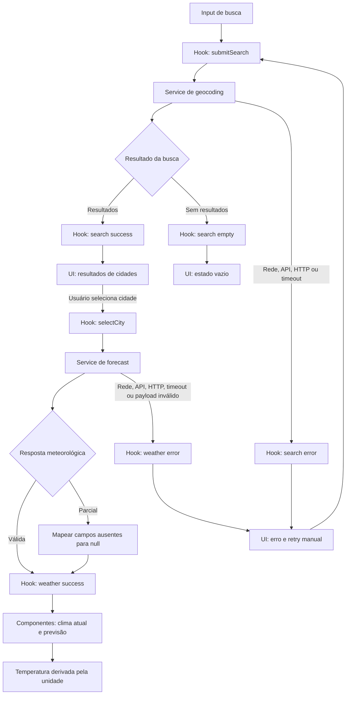

# Weather App — Plano Técnico

## Architecture

Aplicação SPA estática em React, sem backend próprio, organizada em quatro camadas. Dependências seguem uma direção única: apresentação → orquestração → acesso a dados; as funções puras e os tipos são dependências sem efeitos colaterais.

```text
App / components
  ↓ props e callbacks
hooks (estado e casos de uso)
  ↓ chamadas tipadas
services (HTTP, timeout e validação de payload)
  ↓
Open-Meteo APIs

hooks / services ──→ lib (mapeadores e funções puras)
todos os módulos ───→ types (contratos sem comportamento)
```

- **`components/`:** renderiza conteúdo e controles a partir de props, emite callbacks de intenção; não chama APIs nem mantém regras de domínio.
- **`hooks/`:** orquestra busca, seleção, carregamento, retry e unidade; coordena serviços e expõe estado/ações à UI.
- **`services/`:** executa `fetch`, timeout e validação estrutural; traduz falhas de transporte para erros tipados, sem importar React.
- **`lib/`:** mapeia DTOs para domínio e calcula unidades/descrições com funções determinísticas, sem rede, estado ou efeitos colaterais.
- **`types/`:** define os contratos de domínio e os DTOs mínimos do provedor; não contém lógica.

Ao selecionar outra cidade, invalidar solicitações meteorológicas anteriores e limpar os dados exibidos até a resposta da nova seleção. Sem cache, persistência de usuário ou retry automático na primeira versão (AC-04, AC-05, AC-08, AC-13; NFR-05).

## Tech Stack

| Área | Decisão | Rastreabilidade |
| --- | --- | --- |
| UI | React 19 + TypeScript strict | Stack do projeto; FR-01 a FR-05 |
| Build/dev server | Vite | Configuração existente; execução estática e build para GitHub Pages |
| Estilo | Tailwind CSS | Stack e tema definidos nas instruções do projeto; NFR-01 |
| Estado | Hooks nativos React (`useState`, `useEffect`) | Cinco stories em uma SPA pequena; evita estado global e dependências adicionais |
| Testes | Vitest + Testing Library + Playwright | Configuração existente; AC-01 a AC-15 e NFR-01/02 |
| Lint/format | Biome | Scripts já definidos no `package.json` |
| Pacotes | pnpm | `packageManager` definido no projeto |

Não adicionar biblioteca de estado, cliente HTTP ou cache nesta etapa: `fetch`, hooks React e as dependências já instaladas cobrem o escopo.

## Project Structure

```text
src/
  App.tsx                   # compõe useWeatherApp e componentes de tela
  components/
    CitySearch.tsx          # entrada, resultados e estados de busca
    CurrentWeather.tsx      # clima atual e estado da seção
    Forecast.tsx            # cinco dias e estado da seção
    UnitToggle.tsx          # Celsius/Fahrenheit
  hooks/
    useWeatherApp.ts        # estado e ações da tela
  services/
    openMeteoService.ts     # chamadas HTTP, timeout e validação de payload
  types/
    weather.ts              # contratos de domínio
    openMeteo.ts            # DTOs mínimos de geocoding e forecast
  lib/
    weatherMapper.ts        # mapeadores puros de DTO para domínio
    weatherCode.ts          # códigos WMO para rótulos pt-BR
    temperature.ts          # conversão e arredondamento de temperatura
tests/
  unit/
    lib/                    # funções puras: entradas, saídas e limites
    services/               # transporte, timeout e payloads simulados
    hooks/                  # transições de estado e concorrência
    components/             # renderização e interação acessível
  e2e/                      # Playwright com rotas de API interceptadas
```

Cada camada pode importar `types/`; `hooks/` pode importar `services/` e `lib/`; `services/` pode importar `lib/`; `components/` recebe props e não importa `services/`. Esse limite evita chamadas de rede acopladas à renderização e permite substituir serviços por mocks nos testes.

## Data Model

Contratos de domínio propostos; não são a estrutura bruta da API.

```ts
export type Unit = 'celsius' | 'fahrenheit';

export interface City {
  id: string; // ID do resultado do provedor ou chave geográfica estável
  name: string; // Nome retornado pelo geocoding
  latitude: number; // Latitude usada na consulta meteorológica
  longitude: number; // Longitude usada na consulta meteorológica
  admin1?: string; // Região administrativa, quando disponível
  country?: string; // País, quando disponível
  countryCode?: string; // Código ISO do país, quando disponível
  timeZone?: string; // Fuso retornado pelo geocoding, quando disponível
}

export interface WeatherCondition {
  code: number; // weather_code Open-Meteo (código WMO)
  labelPtBr: string; // Descrição localizada para a interface
}

export interface CurrentWeather {
  temperatureCelsius: number | null; // current.temperature_2m normalizada para °C
  condition: WeatherCondition | null; // current.weather_code mapeado para pt-BR
}

export interface ForecastDay {
  localDate: string; // daily.time no fuso da cidade, formato YYYY-MM-DD
  temperatureCelsius: number | null; // Campo daily de temperatura ainda depende da spec
  condition: WeatherCondition | null; // daily.weather_code mapeado para pt-BR
}

export interface WeatherData {
  city: City; // Local selecionado pelo usuário
  timeZone: string | null; // timezone da resposta meteorológica
  current: CurrentWeather; // Condições atuais retornadas pela API
  days: ForecastDay[]; // Cinco datas locais; campos ausentes usam null
}

export type RequestErrorKind = 'network' | 'http' | 'api' | 'timeout' | 'invalid-response';

export interface RequestError {
  kind: RequestErrorKind;
  message: string; // Mensagem segura e localizada em pt-BR; não expor payload bruto
}

export type AsyncState<T> =
  | { status: 'idle' | 'loading' }
  | { status: 'success'; data: T }
  | { status: 'error'; error: RequestError };

export type SearchState = AsyncState<City[]> | { status: 'empty' };
export type WeatherState = AsyncState<WeatherData>;
```

`City.id` deve identificar unicamente o resultado selecionável; usar o identificador do provedor quando disponível e uma chave estável baseada na identidade geográfica quando não estiver. Campos opcionais não devem ser inventados. `WeatherData.days` contém as cinco datas locais esperadas; valores ausentes são `null` conforme AC-10. A decisão sobre qual estatística diária da Open-Meteo alimentar `ForecastDay.temperatureCelsius` (máxima, mínima ou média) permanece pendente e precisa ser resolvida antes de fechar o contrato da API (AC-07, Open Questions 2 e 6).

## Data Flow

1. A tela mantém o texto digitado. No envio, remove espaços externos; string vazia não chama serviço (AC-01/02).
2. `openMeteoService.searchCities(query)` consulta geocoding e `weatherMapper` normaliza os resultados para `City`. Lista vazia vira estado `empty`, distinto de `error` (AC-03/04).
3. Selecionar um resultado atualiza a cidade selecionada, limpa clima anterior e inicia a consulta usando latitude/longitude daquele `City` (AC-05).
4. `openMeteoService.getWeather(city)` solicita clima atual e previsão diária; o mapper normaliza unidades para Celsius, códigos meteorológicos e datas locais.
5. A resposta só atualiza a tela se ainda corresponder à seleção vigente. Solicitações de seleções substituídas são abortadas ou ignoradas (AC-05, NFR-04).
6. A UI apresenta temperaturas convertidas pela unidade em estado. A troca de unidade não refaz a consulta; a preferência dura até fechar ou recarregar a página (AC-11/12).
7. Mensagens e rótulos de condição são apresentados em pt-BR (AC-06/07/14).



## External APIs

Sem API key. Encapsular URLs e payloads exclusivamente em `openMeteoService.ts`.

### Geocoding

**Método e URL:** `GET https://geocoding-api.open-meteo.com/v1/search`

Parâmetros usados: `name=<query>` (texto após remover espaços externos), `count=10`, `language=pt` e `format=json`.

Exemplo resumido de resposta:

```json
{
  "results": [
    {
      "id": 2267057,
      "name": "Lisbon",
      "latitude": 38.7167,
      "longitude": -9.1333,
      "country_code": "PT",
      "country": "Portugal",
      "admin1": "Lisbon",
      "timezone": "Europe/Lisbon"
    }
  ]
}
```

Mapeamento para `City`: `id` vira string estável; `name`, `latitude` e `longitude` são obrigatórios; `admin1`, `country`, `country_code` e `timezone` viram `admin1`, `country`, `countryCode` e `timeZone` opcionais. Não sintetizar valores geográficos ausentes. Resposta 2xx válida sem `results` ou com lista vazia vira estado `empty` (AC-03/04); conteúdo malformado vira `invalid-response`.

### Forecast

**Método e URL:** `GET https://api.open-meteo.com/v1/forecast`

Parâmetros: `latitude` e `longitude` da `City` selecionada; `current=temperature_2m,weather_code`; `daily=weather_code,<daily_temperature_field>`; `temperature_unit=celsius`; `timezone=auto`; `forecast_days=5`. O marcador `<daily_temperature_field>` não é literal: substituir pelo campo diário escolhido pelo produto, por exemplo `temperature_2m_max` ou `temperature_2m_min`. A spec ainda não define qual estatística apresentar, então a consulta e o mapeamento final desse campo permanecem pendentes (AC-07).

Exemplo resumido de resposta. `temperature_2m_max` é usado somente para ilustrar a forma do payload, não como escolha de produto:

```json
{
  "timezone": "Europe/Lisbon",
  "current_units": {
    "temperature_2m": "°C",
    "weather_code": "wmo code"
  },
  "current": {
    "time": "2026-10-27T12:15",
    "temperature_2m": 18.4,
    "weather_code": 2
  },
  "daily_units": {
    "time": "iso8601",
    "temperature_2m_max": "°C",
    "weather_code": "wmo code"
  },
  "daily": {
    "time": ["2026-10-27", "2026-10-28"],
    "temperature_2m_max": [20.1, 21.3],
    "weather_code": [2, 3]
  }
}
```

Mapeamento para o modelo:

- `current.temperature_2m` → `CurrentWeather.temperatureCelsius`; `current.weather_code` → `CurrentWeather.condition.code` e `labelPtBr` pela tabela de códigos validada.
- Para cada índice `i`, `daily.time[i]` → `ForecastDay.localDate`; `daily.<daily_temperature_field>[i]` → `ForecastDay.temperatureCelsius`; `daily.weather_code[i]` → `ForecastDay.condition`.
- `timezone` → `WeatherData.timeZone`; a `City` selecionada → `WeatherData.city`; os objetos `current` e `daily` normalizados → `WeatherData.current` e `WeatherData.days`.
- `current_units` e `daily_units` validam que as temperaturas recebidas são °C; ausência de valor mapeia para `null`, não para zero (AC-06/10). Converter para a unidade escolhida somente na apresentação (AC-11/12).

O código numérico de condição segue os códigos WMO da Open-Meteo; `labelPtBr` exige uma tabela de tradução testada. Confirmar cobertura, limites, atribuição e termos do provedor antes do go-live (AC-06/07; Risks & Trade-offs).

## State Management

Manter estado de aplicação local no hook `useWeatherApp`; sem Redux, Context global ou cache. O hook é a única fonte de verdade para busca, seleção, consulta e unidade; componentes recebem estado via props e notificam intenções via callbacks.

| Estado | Tipo proposto | Regra |
| --- | --- | --- |
| Texto de busca | `string` | Controlado pela UI; trim somente no envio |
| Busca | `SearchState` | `idle` inicial; `loading`; `success` com resultados; `empty` somente para resposta válida sem resultados; `error` para falhas |
| Cidade selecionada | `City | null` | Só muda após seleção explícita |
| Clima | `WeatherState` | `idle` sem seleção; `loading`; `success`; `error`; não usa `empty` |
| Unidade | `Unit` | Inicial `celsius`; permanece na página atual |

Busca e clima têm estados independentes: uma busca vazia não apaga uma consulta previamente selecionada (AC-04). Selecionar cidade inicia `weather=loading`, limpa o clima anterior e invalida a requisição anterior. Retry é explícito e repete os mesmos parâmetros. Não guardar termo, cidade ou unidade em localStorage/servidor (AC-04, AC-05, AC-11, AC-13; NFR-05).

A temperatura armazenada no domínio permanece sempre em Celsius. A UI deriva o valor apresentado durante a renderização; alternar `unit` atualiza a tela, não chama serviços e não altera `WeatherData`:

```ts
function toDisplayTemperature(valueCelsius: number | null, unit: Unit): number | null;
```

Se o valor for `null`, a função retorna `null` e a UI exibe “indisponível”. Para Celsius, retorna o valor original; para Fahrenheit, calcula $F = C \times 9/5 + 32$ e arredonda ao inteiro mais próximo, com metade arredondada para longe de zero, conforme AC-12. Aplicar a conversão tanto ao clima atual quanto a cada dia da previsão.

## Error Handling

- **Rede:** falha de `fetch` (sem resposta HTTP) produz `error.kind='network'`; encerrar loading, mostrar mensagem pt-BR genérica e oferecer retry manual.
- **HTTP/API:** resposta HTTP fora de 2xx produz `error.kind='http'`; resposta 2xx com envelope de erro do provedor produz `error.kind='api'`. Ambos encerram loading e permitem retry manual. Não expor corpo, URL interna ou mensagem bruta do provedor na UI.
- **Timeout:** usar limite de 10 s por solicitação. Cancelar a solicitação com `AbortController`, definir `error.kind='timeout'`, encerrar loading e oferecer retry manual; timeout não é `empty`.
- **Resposta inválida:** JSON ilegível ou estrutura incompatível com o contrato produz `error.kind='invalid-response'`; não tratar como lista vazia nem como resposta parcial.
- **Resposta parcial válida:** manter `status='success'`; mapear somente os campos ausentes para `null`, renderizar “indisponível” para eles e manter os campos válidos. Não inventar ou reutilizar valores anteriores (AC-10).
- **Busca sem resultados:** geocoding 2xx válido com `results` ausente ou lista vazia produz `search.status='empty'`; preservar a seleção e o clima atuais, sem iniciar forecast (AC-04).
- **Falha meteorológica após nova seleção:** preservar o identificador da nova cidade, manter `weather.status='error'` e não restaurar dados da cidade anterior (AC-05/08).
- **Retry:** somente após ação explícita; repetir os mesmos parâmetros para a operação que falhou, sem retry automático (AC-08/09/13).
- **Fuso ausente/inválido:** previsão em estado de indisponibilidade, sem usar o fuso do dispositivo (AC-15).
- **Respostas obsoletas:** abortar quando possível e sempre impedir que resposta de seleção anterior sobrescreva a seleção mais recente (AC-05).

## Testing Strategy

- **Vitest — `lib/` (funções puras):** cobrir conversão Celsius/Fahrenheit com `0`, `100`, negativos, `null` e valores de arredondamento; testar mapeamento de códigos WMO, campos ausentes e datas. Usar entradas/saídas determinísticas, sem rede ou React (AC-02/03/06/07/10/11/12/15).
- **Vitest — `services/` (mock de `fetch`):** verificar URL e parâmetros; resposta 2xx, lista vazia e payload parcial; erro de rede, HTTP não-2xx, envelope de erro da API, JSON/schema inválido, timeout em 10 s e cancelamento. Nenhum teste chama a Open-Meteo real (AC-04/08/09/10/13/15).
- **Vitest + Testing Library — `hooks/`:** mockar serviços e verificar estados `idle`, `loading`, `success`, `empty` (só busca) e `error`; testar seleção, retry com os mesmos parâmetros, resposta obsoleta descartada e troca de unidade sem nova chamada ao serviço (AC-04/05/08/11/12/13).
- **Vitest + Testing Library — `components/`:** renderizar com props/handlers controlados; cobrir a busca em `idle`, `loading`, `success`, `empty` e `error`, e clima em `idle`, `loading`, `success` (incluindo campos indisponíveis) e `error`. Verificar valores/mensagens visíveis, retry, `°C`/`°F`, teclado, foco e semântica acessível. Não acessar serviços nem estado global (AC-01, AC-04, AC-06/07, AC-10, AC-13/14; NFR-02).
- **Playwright — E2E:** usar `page.route` com fixtures para busca → seleção → clima e cinco dias, troca de unidade sem novo request, busca vazia/sem resultado, erro e retry, timeout e troca rápida de cidade sem renderizar resposta antiga (US-01 a US-05; AC-01 a AC-15).
- **Viewport mobile:** executar o fluxo principal em dispositivo mobile configurado e verificar layout/controles em 320 px, sem rolagem horizontal; complementar com 768 e 1280 px e retrato/paisagem (NFR-01). Manter Chromium desktop e projeto mobile existente como base.
- **Rede:** nenhum teste automatizado depende de disponibilidade real da Open-Meteo. Manter fixtures de contrato derivadas de respostas documentadas e um smoke check externo separado apenas se o pipeline permitir acesso à rede.
- **Metas:** lint, build e `pnpm test`; E2E com `pnpm test:e2e`. A medição de Core Web Vitals p75 exige ambiente de coleta e amostra real; não é comprovada por teste unitário (NFR-03).

## Risks & Trade-offs

| Decisão | Alternativa considerada | Trade-off e controle |
| --- | --- | --- |
| Estado local em hook React | Redux, Zustand ou Context global | Menos dependências e fluxo suficiente para uma tela; se surgirem múltiplos fluxos compartilhados, reavaliar. |
| `fetch` direto do browser para Open-Meteo | Backend/proxy próprio | Evita custo e operação de servidor, pois não há API key; acopla o cliente ao provedor e depende de CORS/limites. Confirmar termos e cobertura antes do go-live. |
| Sem biblioteca de cache/requisições | TanStack Query ou SWR | Menos abstração para duas consultas; abre mão de cache, deduplicação e retries automáticos, que não são requisitos atuais. |
| Sem cache e sem modo offline | Cache com validade explícita/PWA | Evita apresentar previsão antiga como atual e reduz complexidade; exige conexão para buscar dados e refaz consultas após reload. |
| Armazenar temperatura em Celsius e derivar unidade na UI | Buscar dados separados por unidade ou armazenar cópias em °C e °F | Uma fonte canônica evita divergência e request extra; conversão e arredondamento precisam ser testados (AC-11/12). |
| Retry manual após erro | Retry automático com backoff | Controle simples e sem amplificar limites do provedor; o usuário precisa iniciar nova tentativa (AC-08/09/13). |
| Provedor externo sem SLA da aplicação | Provedor alternativo ou fallback próprio | Falhas externas podem interromper busca/clima; timeout, erro distinguível e monitoramento reduzem impacto, mas não garantem disponibilidade (NFR-06). |
| Campo diário de temperatura ainda não aprovado | Escolher máxima, mínima ou média | Bloqueia fechar parâmetro e fixture de forecast; resolver com produto antes da integração (AC-07; Open Questions 2 e 6). |
| Código de condição sem mapeamento validado | Exibir somente o código WMO | Rótulos em pt-BR melhoram compreensão, mas exigem tabela e fallback testados (AC-06/07; Open Question 6). |
| Baselines de performance e suporte aguardam aprovação | Fixar metas após validação com stakeholders | Sem aprovação não há gate de lançamento definitivo; confirmar timeout, WCAG, viewports, Core Web Vitals e SLA (NFR-01/03/06; Open Questions 3/4). |